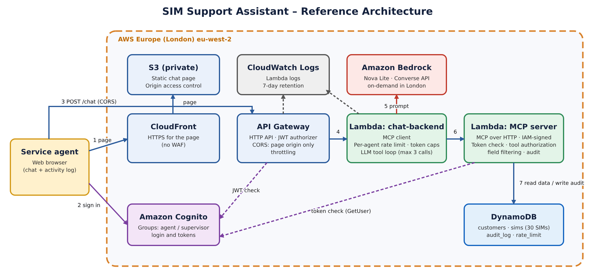
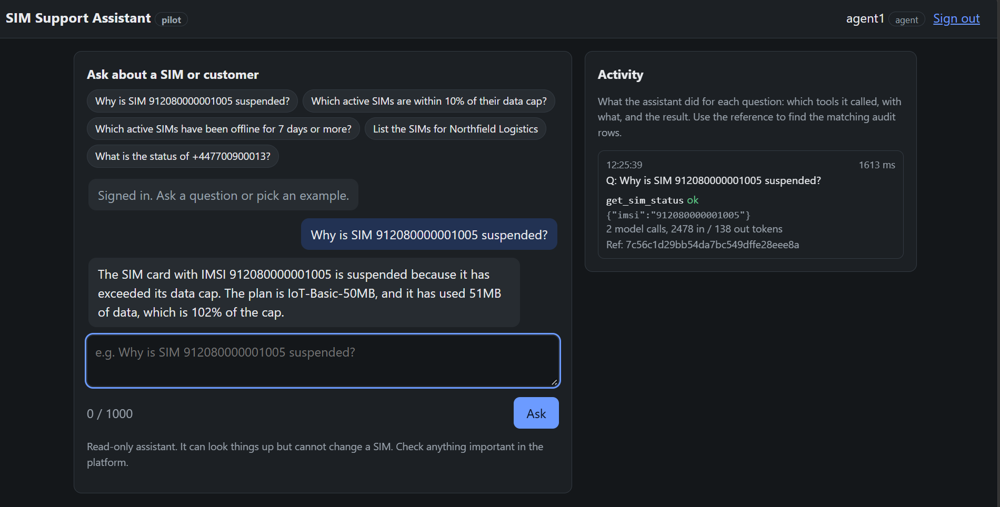
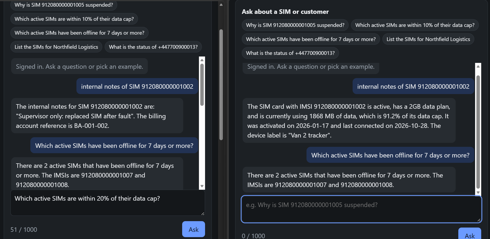

# SIM Support Assistant – High-Level Design

A 10-day pilot of an AI chat assistant for telecom **service agents**. An agent asks a question in plain English ("Why is SIM 912080000001005 suspended?", "Which active SIMs are close to their data cap?") and gets an answer built from SIM data. A language model decides which lookup to run, an MCP server performs it and filters the fields by the agent's role, and every lookup is written to an audit log.

Built on AWS in London (`eu-west-2`) for near-zero cost, with **fictional data only**, and deleted at the end of the pilot. This repository contains the design only.

| Item | Decision |
|---|---|
| Users | Service agents and supervisors (2–3 test users) |
| Data | 30 fictional SIMs, 6 fictional customers |
| Model | Amazon Nova Lite on Amazon Bedrock, on-demand in London |
| Lifetime | 10 days, then everything is deleted |
| Cost target | Near zero; the only real cost is model tokens, capped in the app |
| Not in scope | Real customer data, company SSO, WAF, tamper-proof audit archive |

## Architecture

Everything runs in one AWS region with no VPC and no NAT gateway, so nothing bills by the hour.

There are **two Lambda functions with different jobs**, and only one of them is an MCP server:

- **chat-backend** is the *MCP client*. It talks to the language model and decides, with the model, which tool to call.
- **MCP server** exposes the SIM tools and is the only code that touches the data. Any other MCP client could reuse it unchanged.

Keeping them apart means the part that talks to a model never has direct access to the database, and the data access rules live in one place.

## Components

| Element | What it does |
|---|---|
| Service agent (browser) | Signs in and chats; an Activity panel shows which tools the assistant called for each question |
| S3 (private bucket) | Holds the static chat page; reachable only through CloudFront |
| CloudFront | Serves the page over HTTPS (no WAF in the pilot) |
| Amazon Cognito | Logs agents in, issues tokens, and holds the `agent` and `supervisor` groups that decide each user's role |
| API Gateway (HTTP API) | Public entry point for `POST /chat`; its JWT authorizer rejects requests without a valid token, and throttling limits request rates |
| Lambda: chat-backend | The MCP client. Applies per-agent rate limits and token caps, talks to the model, and runs the tool loop (at most 3 tool calls per question) |
| Amazon Bedrock (Nova Lite) | The language model; chooses which tool to call and writes the final answer from tool results only |
| Lambda: MCP server | Exposes the five SIM tools; validates the agent's token, checks the role against each tool, filters fields, and writes the audit row before returning data |
| DynamoDB | Four small tables: `customers`, `sims` (30 fictional SIMs), `audit_log` (10-day expiry) and `rate_limit` |
| CloudWatch Logs | Lambda logs with a 7-day retention |

## How a question flows

1. The agent signs in through Amazon Cognito; the page keeps the login token in memory only.
2. The page calls `POST /chat` on API Gateway (CORS allows only the page's origin); a JWT authorizer checks the token before anything else runs.
3. The chat-backend Lambda counts the agent's requests and refuses if they are over the limit.
4. It sends the question and the tool list to Nova Lite on Bedrock, which replies with a tool request.
5. The chat-backend calls the MCP server over HTTPS, signed with its IAM role and carrying the agent's token, which the MCP server verifies again.
6. The MCP server reads DynamoDB (through a mock of the GetSIM API), keeps only the fields the agent's role may see, and writes an audit row.
7. Nova Lite writes the answer from the tool result only; the page shows it with an Activity panel listing the tool calls for that request.

## Screenshots and demo

*An agent asks why a SIM is suspended; the Activity panel shows the `get_sim_status` call, token counts and a reference for the audit rows.*

*The same question about internal notes. Left: a supervisor gets the notes and billing reference. Right: an agent gets only the standard fields.*

A short walkthrough (about 50 seconds, no audio) is in [docs/demo/demo-walkthrough.mp4](docs/demo/demo-walkthrough.mp4). It shows a lookup by phone number, a customer's SIM list, and a follow-up status question that is answered from the results already retrieved in the same conversation, so the Activity panel shows no new tool call for it.

## Key decisions

| Area | Choice | Why |
|---|---|---|
| Model | Amazon Nova Lite, on-demand in London | Passed all six model checks I defined, allows 100 requests per minute, and needs no Marketplace subscription |
| Database | DynamoDB, provisioned, four tables | Every question is a key lookup; fits the always-free allowance; no VPC needed |
| Tool layer | MCP over HTTP (stateless) on a Lambda Function URL with IAM auth | Reusable by any MCP client; only the chat-backend's role can call it |
| Identity | Cognito access token checked at API Gateway and again inside the MCP server; role comes from the Cognito group | Stops the MCP server trusting whatever the caller claims; company SSO can federate into Cognito later |
| Edge | CloudFront (static page) + API Gateway HTTP API, no WAF | A WAF's monthly fee is not worth it for 10 days; token check and throttling remain |
| Audit | DynamoDB table with 10-day expiry; the MCP role can only add rows | Archive and streaming pipeline dropped for cost; not tamper-proof |
| SIM data source | Mock that reads the `sims` table | Real SIM-state API sample not available yet |
| Guardrails | Field allowlists, label truncation, delimited tool output, read-only tools | Keeps cost down; injection risk limited because every tool is read-only |
| Limits | 3 tool calls and 5 model calls per question, 700 output tokens, 1,000-character message, 10 requests per minute and 200 per day per agent | Caps cost and abuse |

## Tools

All tools are read-only and each declares the roles allowed to call it; the MCP server enforces that from the verified token.

| Tool | Purpose | Roles |
|---|---|---|
| `find_customer` | Find customers by name or email fragment | agent, supervisor |
| `list_customer_sims` | A customer's SIMs with state, plan, usage | agent, supervisor |
| `get_sim_status` | One SIM by IMSI, MSISDN or ICCID | agent, supervisor |
| `find_sims` | Filter by state, customer, near data cap, or offline days | agent, supervisor |
| `get_sim_internal` | Internal notes and billing reference | supervisor only |

## Testing

- Offline unit tests for the MCP server and the chat-backend, using fake model, tool and database clients.
- End-to-end checks against the deployed stack: signed access, token checks, role filtering, injection handling, audit rows.
- A 20-case scripted evaluation of the full system, **20/20 passing**. It covers role boundaries, a prompt-injection label, bad input, unknown SIMs, out-of-scope questions and requests to change a SIM. The first run was 19/20: the model sent a 16-digit IMSI and the server correctly refused it; making the tool description explicit about the 15-digit format fixed it.

## Limitations

Deliberate, to keep a 10-day pilot cheap: fictional data only; no WAF, Secrets Manager, Bedrock Guardrails, response streaming or X-Ray; the audit log can be altered by an account administrator; the SIM-state API is mocked. Real customer data would first need an answer on where model inference runs, an agreed audit retention period, a WAF, a tamper-resistant audit archive, managed secrets and company SSO.

## License

Copyright (c) 2026 Amey Paranjape. All rights reserved. Shared for viewing and evaluation only; see [LICENSE](LICENSE).
